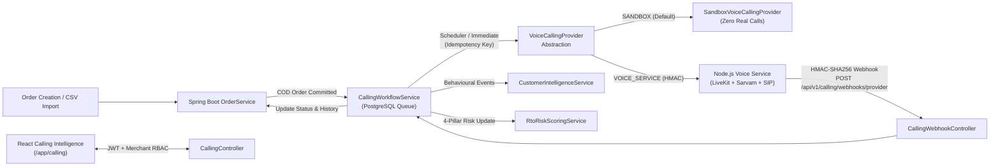

# NORTHSTAR — AI Calling Agent Architecture & Integration Specification

*Navigate Commerce with Clarity.*

---

## 1. Executive Summary & Core Invariant

The **NORTHSTAR AI Calling Agent** automates outbound Cash-on-Delivery (COD) order verification for e-commerce merchants across India.

> [!IMPORTANT]
> **Foundational Business Invariant:**  
> **Every eligible COD order enters the AI calling workflow regardless of its RTO risk score.**  
> Low-risk (`LOW`), medium-risk (`MEDIUM`), and high-risk (`HIGH`) COD orders—from both new and returning buyers—are enrolled automatically. The **AI Calling Agent** verifies purchase intent and delivery readiness, while the **RTO Risk Engine** evaluates multi-factor risk using the resulting call signals. RTO risk never suppresses the initial verification call.

---

## 2. Reference Repository Audit (`meshpilot-hq/ai-voice-agent`)

We audited the complete `meshpilot-hq/ai-voice-agent` repository (`MIT License`, Copyright (c) 2026 ai-voice-agent contributors):

### Reusable Components & Patterns Adopted
1. **LiveKit + Sarvam AI + OpenAI Voice Stack (`src/livekit-agent.js`, `src/trigger-livekit-call.js`)**:
   - **STT**: `Sarvam Saaras v3` (`saaras:v3`) for Hindi/Hinglish (`hi-IN`) code-switching; `OpenAI gpt-4o-transcribe` for Indian-accented English (`en-IN`).
   - **TTS**: `Sarvam Bulbul v3` (`bulbul:v3`, 8 kHz telephony PCM) for natural Indian prosody, with optional ElevenLabs fallback.
   - **LLM**: `OpenAI gpt-4o-mini` (low-latency streaming tool calling).
   - **VAD & Turn Detection**: Silero VAD (`8000 Hz`, `400ms` silence) + LiveKit Multilingual Turn Detector.
   - **Telephony / SIP**: LiveKit SIP Trunking routing `+91` numbers via DLT-registered **Vobiz** SIP trunks and international numbers via **Twilio**.
2. **TRAI Do-Not-Disturb (DND) Window Enforcement (`src/lib/dnd.js`)**:
   - Enforces Indian telecom regulations restricting outbound voice calls to `09:05–21:00 IST`. Calls created between `21:00 IST` and `09:05 IST` automatically roll forward to `09:05 IST` the next valid morning.
3. **Indian E.164 Phone Normalization (`src/lib/phone.js`)**:
   - Normalizes raw checkout numbers and validates `+91[6-9]\d{9}` before SIP trunk origination.
4. **Voicemail Detection (`src/livekit-agent.js`)**:
   - Regex detection across Hindi Devanagari and English answering-machine phrases during the first 4 turns to terminate voicemail loops immediately and conserve SIP minutes.
5. **Two-Phase Dispatch Safety (`src/lib/scheduler.js`)**:
   - Separates pre-call dispatch errors (safe to retry with backoff) from post-placement bookkeeping errors (never auto-retried, preventing duplicate customer calls).
6. **Dry-Run / Sandbox Safety Gate**:
   - Prevents accidental PSTN calls during development and testing unless `LIVE` mode is explicitly enabled.

### Reference Repository Limitations Fixed in NORTHSTAR
1. **Missing `profiles/` Directory**: The upstream repo omitted its `profiles/` folder (`src/lib/profiles.js` fails to load `ai-voice-agent/agent.js` out-of-the-box). NORTHSTAR ships a complete, runnable `northstar-cod-verify` profile inside `voice-service/profiles/northstar-cod-verify/`.
2. **Competing Prisma Database Eliminated**: Upstream maintained a separate Prisma schema (`Session`, `ScheduledCall`, `CallAttempt`, `CallTurn`) coupled to Shopify. In NORTHSTAR, **Spring Boot + Supabase PostgreSQL** is the sole source of truth; `voice-service/` is a stateless voice execution bridge communicating via HMAC-signed REST/webhooks.
3. **Strict Attribution & Git Isolation**: Reusable Node.js voice worker patterns retain their MIT copyright notice in `voice-service/LICENSE.third-party.txt`. No external repository owners or accounts are added to NORTHSTAR's Git history, contributors, or repository permissions.

---

## 3. System Architecture & Service Boundaries

---

## 4. Call Lifecycle & Outcome State Machine

### Session Statuses (`CallSessionStatus`)
- `QUEUED` — Enrolled COD order awaiting initial dispatch (or scheduled for `09:05 IST` post-DND).
- `DISPATCHING` — Claimed atomically by dispatcher; outbound request in flight to voice provider.
- `IN_PROGRESS` — Provider accepted call (`provider_call_id` / `room_name` assigned); ringing or active conversation.
- `RETRY_SCHEDULED` — Previous attempt ended in `NO_ANSWER`, `BUSY`, or transient failure below `max_attempts`; awaiting `next_attempt_at`.
- `COMPLETED` — Terminal outcome reached (`CONFIRMED`, `REJECTED`, `CANCELLATION_REQUESTED`, `INVALID_NUMBER`, or retries exhausted with `NO_ANSWER`/`BUSY`).
- `ESCALATED` — Routed to human operations specialist (`HUMAN_ESCALATION` or manual operator escalation); automated calls halted.
- `STOPPED` — Manually stopped by merchant operator or suppressed due to customer DNC opt-out (`do_not_call_further = true`).
- `FAILED` — Unrecoverable provider failure after exhausting retries (`CALL_FAILED`).

### Structured Conversation Outcomes (`CallOutcome`)
- `CONFIRMED` — Buyer confirmed order, items, address, and COD readiness. Transitions `CREATED -> CONFIRMED` (when auto-confirm is enabled).
- `REJECTED` — Buyer denied placing the order. Stops further calls, logs high-severity RTO signal, flags order for review.
- `CANCELLATION_REQUESTED` — Buyer asked to cancel. Sets `do_not_call_further = true`, transitions `CREATED -> CANCELLED` (when configured) or flags for immediate pre-dispatch cancellation.
- `NO_ANSWER` — Unanswered within ring timeout. Schedules retry (`+30m`, then `+120m`, DND-adjusted) up to `max_attempts`. **Never classified as fraud.**
- `BUSY` — Line busy. Schedules retry with backoff up to `max_attempts`.
- `UNCERTAIN` — Conversation ended inconclusively; flagged for review or retry if attempts remain.
- `INVALID_NUMBER` — Unparseable or unroutable number; stops automated retries and flags order for address/phone correction.
- `HUMAN_ESCALATION` — Buyer requested a human agent or asked out-of-scope policy questions; transitions session to `ESCALATED`.
- `CALL_FAILED` — Telephony/SIP transport error.

---

## 5. Database Schema Changes (`V5__ai_calling_agent.sql`)

All tables reside in Supabase PostgreSQL (`public` schema), managed strictly by Flyway with `spring.jpa.hibernate.ddl-auto=validate`:

1. `calling_configurations` — Merchant-scoped settings (`enabled`, `provider`, `default_language`, `supported_languages`, `max_attempts`, `retry_backoff_minutes_1`, `retry_backoff_minutes_2`, `call_timeout_seconds`, `dnd_start_hour_ist`, `dnd_end_hour_ist`, `auto_confirm_order_on_yes`, `auto_cancel_order_on_request`).
2. `customer_calling_preferences` — Merchant-scoped DNC / opt-out status and preferred language per `customer_id`.
3. `call_sessions` — One row per COD order (`UNIQUE (merchant_id, order_id)`, `UNIQUE (idempotency_key)`), optimistic `@Version`, attempt counters, before/after RTO risk snapshots, AI summary, buyer intent, and recommended next action.
4. `call_attempts` — Per-attempt execution record (`attempt_number`, `provider`, `provider_call_id`, `room_name`, `duration_seconds`, `recording_url`, `consent_disclosed`, `started_at`, `ended_at`).
5. `call_transcripts` — Utterance-level turns (`UNIQUE (call_attempt_id, turn_index)`, `speaker_role`, `utterance_text`, `language`, `confidence`).
6. `call_events` — Immutable audit log + webhook replay protection (`UNIQUE (webhook_event_id)`).
7. `customer_behavioural_events` constraint update — Expands `chk_cbe_event_type` to record `CALL_VERIFICATION_CONFIRMED`, `CALL_VERIFICATION_REJECTED`, `CALL_CANCELLATION_REQUESTED`, `CALL_NO_ANSWER`, and `CALL_HUMAN_ESCALATION`.

---

## 6. Four-Pillar RTO Intelligence Integration

`RtoRiskScoringService` (`com.ordexa.risk`) evaluates orders across four transparent, additive pillars without overwriting historical signals:

1. **Behavioural Risk**: First-time COD buyer (`+12`), prior order cancellations (`+24` / `+45`), verified returning buyer discount (`-25`).
2. **Order-Related Risk**: Incomplete address/landmark (`+30`), high-value COD threshold (`+28`), unconfirmed COD intent (`+22`), prepaid discount (`-30`).
3. **Calling Outcome Signal**:
   - `CONFIRMED`: Clears `CONFIRMATION_PENDING` and applies `CALL_CONFIRMED_INTENT` (`-18`).
   - `REJECTED`: Applies `CALL_DENIED_ORDER` (`+55`) → `HIGH` risk.
   - `CANCELLATION_REQUESTED`: Applies `CALL_CANCELLATION_INTENT` (`+40`).
   - `NO_ANSWER` / `BUSY`: `CALL_UNANSWERED_NEUTRAL` (`+0` on early attempts; `+15` `REPEATED_UNANSWERED_CALLS` review signal only after all retries are exhausted—never treated as fraud).
   - `INVALID_NUMBER`: Applies `CALL_INVALID_PHONE_NUMBER` (`+35`).
   - `HUMAN_ESCALATION` / `UNCERTAIN`: Applies `CALL_REQUIRES_HUMAN_FOLLOWUP` (`+12`).
4. **Historical Customer Confirmation Behaviour**:
   - `>= 2` prior confirmed COD calls with zero rejections: `HISTORICAL_CALL_RELIABLE` (`-12`).
   - `>= 2` prior rejected COD calls: `HISTORICAL_CONFIRMATION_FAILURE` (`+18`).

---

## 7. Security, Compliance & Cost Model

### Security & Multi-Tenancy
- All `/api/v1/calling/**` merchant endpoints require JWT authentication and resolve `merchant_id` exclusively from `TenantContextHolder` (`VIEWER` for reads, `OPERATOR` for retry/stop/escalate, `ADMIN`/`OWNER` for configuration updates).
- `POST /api/v1/calling/webhooks/provider` validates `X-Northstar-Signature` (`HMAC-SHA256(timestamp + "." + rawBody, webhookSecret)`), enforces a 5-minute timestamp window, and deduplicates `webhook_event_id`.

### Indian Telecom Compliance (TRAI)
- Enforces `09:05–21:00 IST` calling hours by default.
- Discloses automated calling & recording consent in the opening greeting.
- Honors customer opt-out / DNC (`customer_calling_preferences.opted_out`) immediately across future COD orders.

### Estimated Cost per Call (90-Second Average Indian COD Call)
| Component | Provider Assumption | Est. Cost (INR / 90s call) |
| :--- | :--- | :---: |
| **SIP Outbound PSTN (`+91`)** | Vobiz DLT SIP Trunk (~₹0.60–₹0.80/min) | ₹1.05 |
| **STT (`hi-IN` / `en-IN`)** | Sarvam Saaras v3 / OpenAI `gpt-4o-transcribe` | ₹0.65 |
| **TTS (`hi-IN` / `en-IN`)** | Sarvam Bulbul v3 (`8 kHz` telephony) | ₹0.75 |
| **LLM Reasoning & Summary** | OpenAI `gpt-4o-mini` (~800 in / ~180 out tokens) | ₹0.12 |
| **WebRTC / SIP Orchestration** | LiveKit Cloud SIP + Agent Session | ₹0.45 |
| **Total Estimated Cost** | **Per connected 90s COD call** | **~₹3.02 / call** |

*(Unanswered / busy calls incur zero STT/TTS/LLM/SIP connect charges on per-second Indian SIP trunks, making universal COD verification highly ROI-positive compared to ₹140–₹180 forward+reverse RTO freight burn.)*
